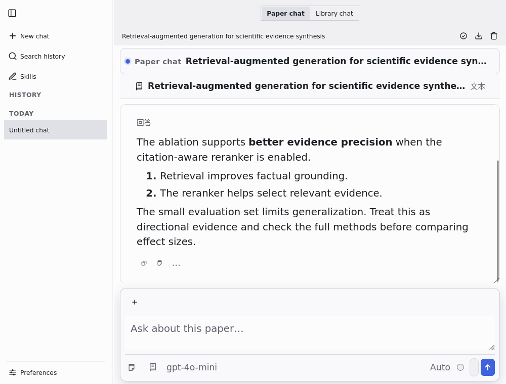
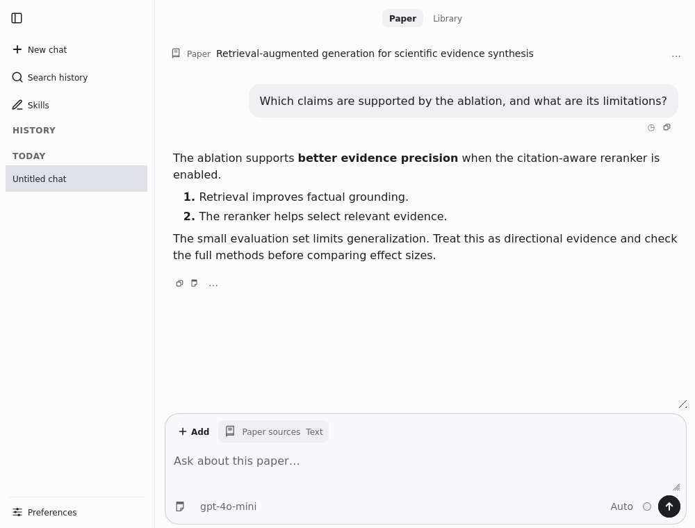
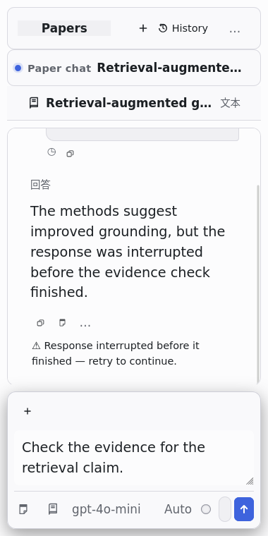
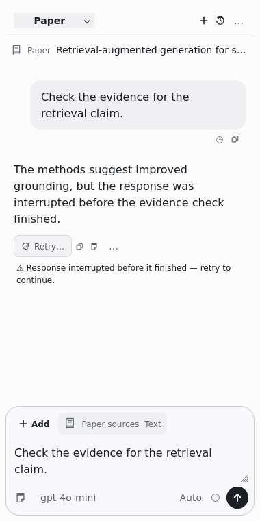

# LLM for Zotero：以论文阅读为中心的 UI/UX 重设计

四轮真实 A/B 迭代后的设计：**论文 / 文献库作用域 → 当前资料 → 对话 → 来源与输入**。减少重复标题和框线，将低频操作收进 More；保留可见的资料身份、来源检查、模型选择、停止、重试、引文与笔记能力。

**核心阅读场景是左侧 PDF、右侧问答侧栏。** 问答使用 Zotero 阅读器的原生右侧面板，独立窗口用于扩展工作区。完整阅读器入口、布局取舍及追加验证见[阅读器侧栏](reader-sidebar.md)；独立窗口左侧的历史导航是另一项功能。

基线：`51c574544d860b670fb34000717c78f829e81f6e`，目标分支 `codex/papers`。三个 GPT‑6.1 sol 子代理分别完成参考研究、产品 IA、代码/状态审查，随后按文件所有权并行实现，并对每轮截图独立进行配对审查。主代理统一设计、集成与验收。没有更改会话存储结构、模型调用协议或发布版本号。

## 初始 A / 最终 B

以下均由运行中的 Zotero/Gecko 捕获，使用同一论文与对话 fixture。宽图为原生独立窗口；380px 图为挂在测试宿主上的生产组件裁剪，不能单独证明完整 PDF 阅读器中的侧栏布局。

| 1000 × 760：论文对话 A | 1000 × 760：论文对话 B |
| --- | --- |
|  |  |

| 380 × 760：嵌入式恢复状态 A | 380 × 760：嵌入式恢复状态 B |
| --- | --- |
|  |  |

原始窄面板中，重复标题和多层容器挤压了阅读区域，错误恢复需要寻找隐藏操作。最终版本保留一处论文身份，回答直接呈现在画布上；来源位于输入旁，失败回答有明确的 Retry，错误正文可换行。代价是设置、导出与运行模式多一次 More 展开，换取长期阅读所需的宽度；这些原有操作仍可到达。

## 主要页面与关键状态

| 页面/状态 | 最终原生截图 |
| --- | --- |
| PDF 与原生右侧问答并排 | [堆叠布局](evidence/reader-sidebar/01-reader-stacked-full.png) · [全高布局](evidence/reader-sidebar/02-reader-independent-full.png) · [约 380px 侧栏](evidence/reader-sidebar/03-reader-independent-narrow-full.png) · [来源展开](evidence/reader-sidebar/04-reader-sources-expanded-full.png) |
| 论文初始页、正常对话 | [初始页](evidence/round-4/01-paper-empty-wide.png) · [对话](evidence/round-4/02-paper-conversation-wide.png) · [500px 对话](evidence/round-4/04-paper-conversation-narrow.png) |
| 文献库初始页、暗色 | [宽窗口](evidence/round-4/09-library-empty-wide.png) · [窄窗口](evidence/round-4/10-library-empty-narrow.png) · [暗色](evidence/round-4/11-library-empty-narrow-dark.png) |
| 等待、停止与恢复 | [发送中](evidence/round-4/05-paper-running-wide.png) · [500px 错误](evidence/round-4/07-paper-error-narrow.png) · [Retry 模型菜单](evidence/round-4/16-retry-model-menu-wide.png) · [380px 长错误](evidence/round-4/21-long-error-embedded-380.png) |
| 来源与低频工具 | [380px 完整来源标题](evidence/round-4/18-sources-embedded-380.png) · [380px More](evidence/round-4/19-more-embedded-380.png) |
| 找回对话 | [历史检索](evidence/round-4/20-history-search-narrow.png) · [新建并保留论文作用域](evidence/round-4/17-new-paper-from-sidebar-wide.png) |
| 中文、长模型名、大字体 | [中文](evidence/round-4/22-chinese-paper-embedded-380.png) · [380px 字体/模型压力场景](evidence/round-4/25-paper-long-model-font150-embedded-380.png) |
| 暗色论文对话 | [暗色对话](evidence/round-4/12-paper-conversation-wide-dark.png) |

## 四轮取舍记录

每轮以之前接受的版本为 A。没有使用绝对分数决定保留。

| 轮次 | 实际代码与核心问题 | A/B 证据与决定 | 下一轮重点 |
| --- | --- | --- | --- |
| 1：阅读层级 | 统一 Paper/Library 标签与身份行；来源靠近输入；移除重复容器；重设灰阶、12/14/16 字号、气泡与发送按钮；区分空对话和历史加载失败。 | [A](evidence/round-0/13-embedded-paper-380.png) / [B](evidence/round-1/13-embedded-paper-380.png)：相同 380px 面板能容纳更多正文，保留。发现重复加号、错误被截断、展开导航时重复入口。 | 明确恢复操作并消除重复入口。 |
| 2：恢复与操作 | 错误状态移至独立整行；失败回答显示 Retry；统一 Add；展开侧栏时隐藏重复 New/History；修正 More 空白删除项与重复 pop-out。 | [A](evidence/round-1/07-paper-error-narrow.png) / [B](evidence/round-2/07-paper-error-narrow.png)：完整错误与下一步可见。含双加号/空白项的[中间候选](evidence/round-2-candidate)被拒绝，修复重跑后保留。Retry 实际打开原模型菜单。 | 完整来源标题、历史检索与 380px 错误。 |
| 3：核对与找回 | 来源展开后显示真实论文标题；历史输入直接获得焦点；统一结果作用域；Tab 边界、Escape、焦点返回与失败/无结果区分。 | 来源 [A](evidence/round-2/18-sources-embedded-380.png) / [B](evidence/round-3/18-sources-embedded-380.png)：从泛称变为可核对的完整标题。B 搜索实际验证不存在查询为空，再查询 evidence 命中并高亮。保留；发现 Delete 显示会改变焦点集合。 | 稳定键盘顺序，清理搜索摘要，检查中文和字体压力。 |
| 4：检索完成度与原生兼容 | Delete 保留稳定占位与焦点环；摘要转纯文本但保留代码/数学并对语法查询回退；推理标签翻译而不改模型值；历史恢复按钮使用 XHTML namespace；恢复后台运行圆环。 | 搜索 [A](evidence/round-3/20-history-search-narrow.png) / [B](evidence/round-4/20-history-search-narrow.png)：移除 Markdown 噪声，实际高亮仍成立。焦点集合由 3→4 变为稳定 4→4；中文 Auto→自动。字体压力下 Send 与模型几何不变，故不改原布局。保留。 | 收敛；剩余工作转为已存在的引文状态问题和真实服务集成验证。 |

每轮的三份独立评审均回答任务收益、解决/剩余问题、新回退、保留/撤销和下一步：

| 轮次 | 参考与视觉 | IA 与任务 | 状态与回退 |
| --- | --- | --- | --- |
| 1 | [参考](round-1-reference.md) | [IA](round-1-ia.md) | [状态](round-1-states.md) |
| 2 | [参考](round-2-reference.md) | [IA](round-2-ia.md) | [状态](round-2-states.md) |
| 3 | [参考](round-3-reference.md) | [IA](round-3-ia.md) | [状态](round-3-states.md) |
| 4 | [参考](round-4-reference.md) | [IA](round-4-ia.md) | [状态](round-4-states.md) |

## 参考产品与实际采用的原则

| 可核实的官方来源 | 实际观察与采用 | 取舍 |
| --- | --- | --- |
| [ChatGPT macOS companion 历史官方截图](https://help.openai.com/en/articles/9703738-chatgpt-macos-app-release-notes) | 无框回答、中性用户气泡、底部统一输入、单一醒目的发送按钮。 | 采用窄窗口的阅读模式，保留 Zotero 专有的论文、引文与笔记入口。引用的是明确日期的官方界面，不声称是所有当前客户端的样式。 |
| [NotebookLM 官方三面板演示](https://blog.google/innovation-and-ai/models-and-research/google-labs/notebooklm-new-features-december-2024/) | 来源与下一次提问关联；来源面板可折叠，聊天区域可扩展。 | 在 Zotero 380px 面板用来源 disclosure，宽独立窗口才保留可收起历史栏。 |
| [Zotero PDF 阅读器与笔记编辑器](https://www.zotero.org/support/pdf_reader) | 论文上下文持续可辨识，引文能回到原文，研究结果可进入笔记。 | 保留真实引用和笔记操作，不以泛化聊天界面取代研究工作流。 |
| [Radix Colors 语义色阶](https://www.radix-ui.com/colors/docs/palette-composition/understanding-the-scale) | 分离背景、边界、状态及文本角色，浅色和暗色分别映射。 | 使用仓库现有色阶与主题机制；主操作使用中性深色，状态和焦点保留功能性色彩。 |

详见[原始参考研究](reference-research.md)、[产品审查](product-audit.md)、[代码审查](code-audit.md)与[统一设计决定](decision.md)。

## 重要变化

| 层面 | 最终行为 |
| --- | --- |
| 信息架构 | 作用域、当前论文、对话、输入各有一个明确位置；运行模式与内容来源不再像竞争导航。 |
| 核心交互 | 来源可展开核对全名；历史可直接搜索；弹窗可用键盘关闭并返回触发控件；错误保留问题和部分答案，提供 Retry；运行状态与模型设置分行。 |
| 视觉 | 原生 DOM 保持；中性灰阶、无框回答、单一输入表面；12/14/16 语义字号及用户缩放；0.5px 分隔、2px 焦点；功能性加载圆环保留，减少动态效果设置仍生效。 |
| 一致性 | 独立窗口和嵌入面板共享主要布局；英文/中文作用域与动作名称统一；暗色使用独立语义映射。 |

## 运行证据和边界

环境：Linux，Zotero **10.0.6 / Gecko 140**，1440×1000 虚拟显示器，独立测试 profile。截图通过运行中的 Gecko 原生窗口取得。PDF、论文条目、历史和待发送请求是确定性 fixture；没有使用用户资料或调用收费模型。

- 独立窗口比较为 1000×760 和 500×760；系统将请求的更窄独立窗口限制为 500px。380×760 是生产组件在测试宿主中的原生渲染裁剪，未走完整 reader section 生命周期；完整 PDF 与问答并排证据另见[追加侧栏验证](reader-sidebar.md)。
- 第 1 轮前三张宽图高度曾为 779px，因此其主要配对结论使用尺寸一致的 500px/380px 图。后续与最终宽图已固定为 1000×760。
- `23` 是生产组件的 null 分支检查，缺少宿主完整初始化，**不用于最终无选择界面的 A/B 结论**。
- `24` 专门验证 Delete 焦点和暗色；背景出现的中英混排来自测试切换语言后旧窗口未整体重建，不用它做语言结论。语言验收使用 `22`。
- `25` 的字体偏好是 150%，相当于基线 120% 的 1.25 倍，不是操作系统缩放。长模型名称写入实际配置作为显示压力 fixture，并不声称该名称可被服务商调用。
- 待发送、错误、Retry 菜单与历史加载失败的状态检查不等于真实模型服务或数据库故障的端到端验证。

### 最终检查结果

| 检查 | 实际结果 |
| --- | --- |
| `npm run build`（production XPI + 两套 TypeScript 检查） | 通过；版本 `3.14.8-papers.1`，ZIP 完整性与 manifest 已检查。安装包 SHA-256 见 [artifact.json](validation/artifact.json)。 |
| 原生 UI 场景 | 最终重跑通过，26 张截图；组件/语言过渡场景的限制见上文。 |
| 追加原生阅读器侧栏 | **1 条连续工作流通过，8 张整窗截图**：1360×900 下 PDF 与问答并排、两种布局、原生宽度设置、来源/Escape、收起恢复、论文切换和对应草稿/历史恢复。[运行输出](validation/native-reader-sidebar.txt)及[取舍与边界](reader-sidebar.md)。 |
| 核心原生工作流 | **21 通过，1 个明确跳过的既有失败**。实际读取 PDF、引用分组/重新打开/跳转并高亮原文、选中文本、带图笔记复制、模式切换、后台会话切换、取消和运行计时均通过。[运行输出](validation/native-workflows.txt)。 |
| 7 类状态源码执行检查 | 无论文、论文、文献库、笔记、加载、作用域阻塞及历史失败恢复通过；包括 Retry 的 XHTML namespace。 |
| 全量单元测试 | **8595 通过、1 pending、6 失败**，不是全绿。[完整失败摘要](validation/unit-summary.txt)。其中 5 项偏好设置断言在基线复现；1 项性能计时门槛在全量运行失败，单独重跑通过。没有为此改动被测性能代码。 |
| 修改文件质量 | Prettier、ESLint、`git diff --check` 通过。仓库级 lint 仍被其他文件的既有格式问题阻塞。 |

核心工作流的视觉断言随已批准的设计更新：运行模式先打开真实 More 后测量，正文按实际 16px 下限检查 16/22px 引文，验证支持段落可见而不强制旧的左边线；运行状态验证可见文字与持续计时，不强制装饰性文字闪动。原有完整工作流仍保留展开引文状态失败断言，没有静默删除。

### 尚未解决与未验证

1. **既有引文状态问题**：长对话局部更新时，已展开的引文卡可能收起。当前与原始提交均在原生 Zotero 复现；这项没有算作通过。[基线运行证据](validation/baseline-quote-expansion.txt)。
2. 5 项偏好设置单元断言仍失败，[基线复现](validation/baseline-preferences.txt)；性能计时测试在全量与独立运行之间不稳定。普通 CI 全套不能声称全绿。
3. 本次主范围是论文/文献库对话、来源、历史与恢复；偏好设置页未整体重构。
4. 未使用真实付费模型、WebChat 登录或远端同步凭据，未做 Windows/macOS 原生运行验证。实际数据库故障恢复仅覆盖渲染/重试状态分支，不冒称真实故障注入成功。

相关原生引文截图：[收起](evidence/workflows/paragraph-source-footer-collapsed.png) / [支持段落展开](evidence/workflows/paragraph-source-footer.png)。


## 复现

```bash
npm ci
npm run build
# 使用可运行的本地 Zotero；Linux 无显示器时需在同一进程环境启动 Xvfb
ZOTERO_PLUGIN_ZOTERO_BIN_PATH=/path/to/zotero node scripts/capture-ui-redesign.mjs round-4
# 完整 PDF 阅读器 + 原生问答侧栏；输出完整窗口，不裁成组件
ZOTERO_PLUGIN_ZOTERO_BIN_PATH=/path/to/zotero node scripts/capture-reader-sidebar.mjs
node --import tsx test-ui-redesign/uiState.check.mjs
# 核心流程子集（明确跳过已在基线复现的展开引文问题）
ZOTERO_PLUGIN_ZOTERO_BIN_PATH=/path/to/zotero node scripts/run-ui-regression.mjs
```

常规单元测试为 `npm run test:unit`。本工作环境禁止 tsx CLI 的 Unix socket，因此实际使用等价入口 `node --import tsx node_modules/mocha/bin/mocha.js --require ./test/register.cjs 'test/**/*.test.ts'`。构建产物是 `.scaffold/build` 下的 XPI。

截图目录包含视口、控件几何和 source SHA-256 记录。`round-3-stress` 是第 4 轮修改前增加的压力场景 A，生产代码仍是接受的第 3 轮。仓库已有 `ui-preview` 手绘/代理图片未用于本次证据。
